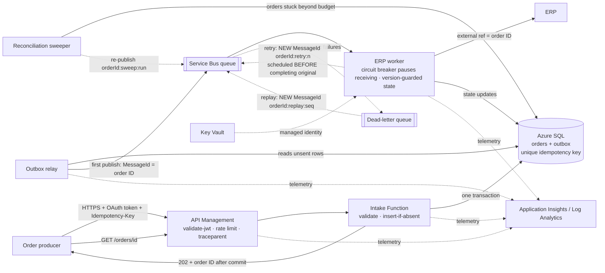

# Order processing — draft architecture (v0.4)

Proposed design for review. Matches `integration-blueprint.json` in this folder. Nothing is deployed.

| Component | Responsibility |
|---|---|
| API Management | Authenticate (Entra ID), throttle, size-limit, add or forward `traceparent`, route |
| Intake Function | Validate; insert order and outbox row in one transaction keyed by the client idempotency key; return 202 or the original result for a repeat |
| Azure SQL | Source of truth for order state; outbox; unique idempotency key; version column for monotonic state |
| Outbox relay | First publish of each order with `MessageId` = order ID and an `OrderId` property; safe to re-run |
| Service Bus queue | Durable buffer through ERP outages; DLQ for deterministic failures only |
| ERP worker | Idempotent ERP call keyed on `OrderId` (external reference); lookup on uncertain outcome; circuit breaker pauses receiving during outages; per-message retries are **new** messages (`{orderId}:retry:{n}`) scheduled before the original is completed |
| Reconciliation sweeper | Re-publishes any order stuck in a non-terminal state beyond the outage budget; the database, not the broker, is the source of truth |
| Key Vault | ERP credentials if the ERP cannot use Entra ID |
| App Insights / Log Analytics | End-to-end tracing, backlog and DLQ alerts, reconciliation dashboards |

Why not call the ERP synchronously: the ERP can be down for 45 minutes, so a synchronous call would fail for the whole outage. The trade-off is that 202 means *accepted*, not *completed*; callers use the status endpoint.

**Message identity rule.** Service Bus duplicate detection also applies to scheduled messages, so a retry or DLQ replay that reused the original `MessageId` would be silently dropped inside the detection window. Only the first publish uses `MessageId = order ID`; every retry, replay and sweep gets its own deterministic ID, and idempotency is enforced on the `OrderId` property.
